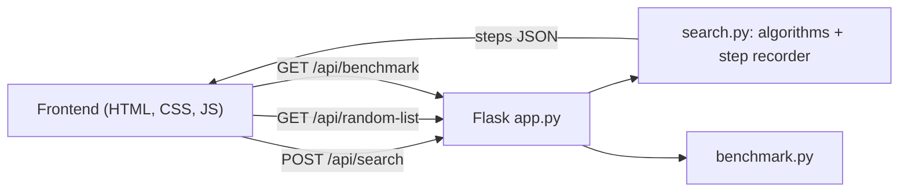

A DSA mini project: binary search implemented in Python, with a visual front end that replays every comparison.

## Features

- Classic binary search, plus first-occurrence and last-occurrence variants for lists with duplicates
- Step-by-step replay: lo / mid / hi pointers, Play, Back, Next, speed control, keyboard shortcuts
- Binary vs linear comparison race for every search
- Python code panel that highlights the line running at each step
- Pure-Python benchmark (linear scan vs binary search) run by the backend
- Input validation (sorted, 1 to 60 whole numbers) on the server

## Structure

```
binary-search-system/
├── backend/
│   ├── app.py            Flask app + API routes
│   ├── search.py         binary search, variants, step recorder
│   ├── benchmark.py      timing code
│   ├── requirements.txt
│   └── tests/test_search.py
├── frontend/
│   ├── index.html
│   ├── css/style.css
│   └── js/app.js
└── README.md
```

## Run it

```bash
cd backend
pip install -r requirements.txt
python app.py
```

Open http://127.0.0.1:5000

Tests: `cd backend && python -m unittest discover tests`

Frontend on its own port? Set `API` at the top of `frontend/js/app.js` to `http://127.0.0.1:5000`.

## How it fits together



## API

| Method | Route | What it does |
| --- | --- | --- |
| GET | `/api/random-list?size=16` | random sorted list, 1 to 60 numbers |
| POST | `/api/search` | body `{array, target, mode}` with mode `any`, `first` or `last`; returns `steps` and `linear` cost |
| GET | `/api/benchmark` | times linear vs binary on 200,000 numbers |

## Complexity

| | Time | Extra space |
| --- | --- | --- |
| Binary search | O(log n) | O(1) |
| Linear search | O(n) | O(1) |

The list must be sorted before binary search works.
